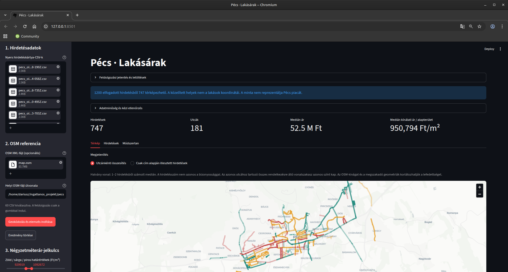

# Urban Property GIS Pipeline

**Python-based, offline geospatial data processing prototype — AI-assisted development.**

This repository demonstrates a reproducible workflow: **structured property listings → schema validation and merging → offline OpenStreetMap address/street matching → data-quality checks → street-level price summaries → interactive map**. The current implementation targets **Pécs, Hungary**.

> **Scope:** an educational prototype, not a production service or a statistically representative property-price dataset. No collected listing records, scraping scripts, or third-party listing exports are included.

## Application Preview


## What the application does

- Ingests semicolon-delimited UTF-8 CSV data with a defined eight-column schema.
- Separates exact address matches from approximate street matches, ambiguous matches, and unmatched records.
- Calculates street-level median offer prices per square metre, supports filters and a browser-based map.
- Exports results and quality-review files; performs processing locally, without live scraping or an online geocoding API.

## Architecture

```text
CSV input → pipeline.py → geokodolo.py + OSM XML → build_streets.py
                         ↓
                quality.py → Streamlit app.py → map / tables / exports
```

## Quick start

Python 3.11+ recommended. From the repository directory:

```bash
python3 -m venv .venv
source .venv/bin/activate
python -m pip install -r requirements.txt
python -m streamlit run app.py
```

The browser UI expects **(1)** a user-provided listing CSV and **(2)** an OpenStreetMap XML extract (`.osm`/`.xml`). This repository does not contain an actual listing dataset or a city-scale map export. For a fully synthetic local demonstration, generate your own sample CSV using the script below and use the bundled *fictional tiny test map*: 

```bash
python examples/make_synthetic_input.py
```

Upload `synthetic_listings.csv` generated locally and `examples/synthetic_test_map.osm` using the sidebar file pickers. This is a narrow functional fixture, **not** a realistic city map or representative property-price analysis.

Expected input columns (semicolon delimiter):

`hirdetes_id;link;cim;ar;ar_m2;alapterulet;szobak;erkely`

Example field names are Hungarian to match the application's current CSV contract.

## Tests

```bash
python -m unittest -v test_app
```

Tests use synthetic inputs. Execution in a fresh installed environment should be verified before claiming full deployment readiness. A public live demo is **not** provided or claimed in this repository.

## Data provenance & responsible publication

- **No real property advertisements or scraped data are distributed here.**
- **No data-acquisition or web-scraping scripts are distributed here.**
- The processing pipeline is **source-agnostic**: it can accept data supplied lawfully in the documented CSV schema.
- The synthetic example is generated locally from fictional records, not from a third-party listing export.
- The app performs no website scraping. Whether an external dataset may legally be used requires a separate check of its rights, source terms, and applicable law.
- The sample OSM XML file is an *independently invented testing fixture*, not a city-scale OpenStreetMap extract. If you supply OSM data, comply with applicable OpenStreetMap attribution/licensing.

## AI-assisted development — English

This project was developed with substantial assistance from AI tools. My primary contribution was defining the problem, establishing the functional requirements, coordinating development, integrating components, and testing the application through practical use. AI tools supported code generation, debugging, and implementation of technical solutions. The project demonstrates my ability to combine geoinformatics knowledge, analytical thinking, and AI-assisted software development to build a functional prototype. I present it as a learning project and evidence of my problem-solving approach, not as proof of fully independent software engineering expertise.

## AI-val támogatott fejlesztés — magyarul

A projekt jelentős mesterségesintelligencia-támogatással készült. Saját szerepem a probléma meghatározása, a funkcionális követelmények kialakítása, a fejlesztési folyamat irányítása, a komponensek összehangolása és a működés gyakorlati ellenőrzése volt. Az AI-eszközök a programkód létrehozásában, hibakeresésben és a technikai megoldások kidolgozásában segítettek. A projektet térinformatikai ismereteim, problémamegoldó gondolkodásom és az AI-val támogatott fejlesztési munkafolyamat bemutatásának szánom, nem teljesen önálló szoftverfejlesztői jártasságom bizonyítékának.

## Limitations

- Hungarian-language UI and Pécs-focused address rules.
- Geocoding precision depends on data quality and OSM coverage. Street-level approximation does **not** identify an exact property location.
- Low counts per street are not representative.
- Streamlit Community Cloud deployment and browser-rendered map tiles are not validated by this package alone.
- The original source data and its acquisition workflow are intentionally outside the scope of this public release.

## Ownership / licensing

This repository does not grant rights to third-party datasets. No open-source licence is asserted for the original code at this stage; contact the repository owner before reuse beyond applicable legal exceptions.
